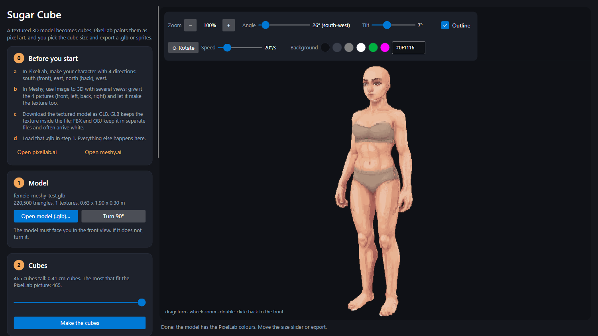
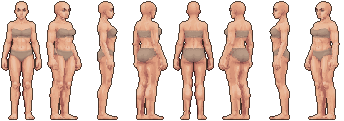
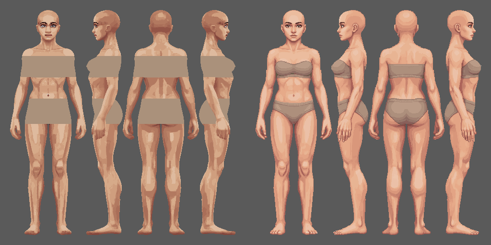

# Sugar Cube

**Turn a textured 3D model into a voxel character that looks exactly like a pixel-art sprite, from every angle.**

Sugar Cube takes a textured 3D model (for example one made by Meshy from your PixelLab sprite), turns it into cubes,
hands four views of those cubes to PixelLab to repaint as real pixel art, and puts every painted pixel back onto the
cube it came from. Then you pick the cube size with a slider and export a `.glb` or a sprite sheet in 8 directions.

> **Tested only with humanoid characters so far.** Everything here was made and checked on standing human figures.
> What it does with an animal or an object (a sword, a chair, a table) is not known yet: it may work, or the four side
> views may not be the right ones to paint.

## Why it exists

I am making a game that should **look 2D but be 3D underneath**.

Hand-drawn sprites look great, but they are dead ends: every outfit has to be redrawn for every frame of every
animation, and every new animation has to be drawn by hand. A 3D character can wear clothes that are fitted once and
follow the body, and it can be animated from real movement with **RGBMoCap** (motion capture from ordinary video).
The catch is the look: a 3D character does not look like pixel art. Sugar Cube closes that gap. The character stays 3D,
so it can be dressed and animated, and it is drawn as cubes whose colours were painted as a sprite, so on screen it reads
as a sprite.

## How much it took to get here

This app is the one thing that worked after a long run of things that did not. The short version:

- **Dressing the sprites directly.** An image model (ChatGPT) asked to put a tunic on a walk cycle frame by frame drew a
  different tunic in every frame. Giving it all nine frames in one 3x3 grid kept the tunic the same, but it redrew the
  body and the face too, and it never kept the pixel grid it was given.
- **Painting textures for a 3D body.** We tried painting the skin of a MakeHuman body by having ChatGPT and PixelLab
  repaint its texture map (the body cut open and laid flat). ChatGPT painted the face upright on a head piece that lies
  sideways, so the eyes landed on the cheeks. PixelLab drew an outline round every piece of the map, and on the body
  every outline became a red seam down the back and round the knees.
- **The Meshy texture.** A Meshy model's texture is hundreds of small scraps in no order. PixelLab could not tell which
  scrap was which and painted eyes on the back and on the forehead.
- **A shape from the pattern alone.** We even tried rebuilding a body only from its texture layout, like sewing a plush
  toy from its pattern and inflating it. A recognisable little person came out, but 23 to 26 cm away from the real body
  on average: MakeHuman's pattern stretches up to 50% inside a single piece.
- **What worked: one cube per pixel.** Seen straight from the front, a voxel model already *is* pixel art: one cube is
  one pixel. So the four side views (front, left, back, right) go to PixelLab side by side on one 512 x 512 picture, at
  their real size, with nothing scaled. PixelLab is at its best there, kept every figure in place, and its pixels go back
  onto the cubes one to one, with no seams and nothing to guess.

That last step was done by hand once, on one character, with a pile of scripts. Sugar Cube makes it a few clicks, so
anyone can do it.

## Before you start: from a sprite to a model

1. In **PixelLab**, make your character with 4 directions: south (front), east, north (back), west.
2. In **Meshy**, use Image to 3D with several views: give it the 4 pictures and let it make the texture too.
3. Download the textured model as **GLB**. GLB keeps the texture inside the one file; FBX and OBJ keep it in separate
   files and often import white ([Meshy: export formats](https://docs.meshy.ai/en/webapp/guides/platform/export-formats)).
4. Load that `.glb` in Sugar Cube. Everything else happens in the app.

## The steps in the app

1. **Model.** Open or drop the `.glb`. The model must face you in the front view; if it does not, press *Turn 90°*.
2. **Cubes.** Choose how many cubes tall (the maximum is what fits the 512 picture for PixelLab) and press
   *Make the cubes*.
3. **PixelLab.** *Save the picture for PixelLab* writes the 512 x 512 PNG with the 4 views, one cube per pixel. On
   pixellab.ai, edit it with the app's prompt (*Copy the prompt*); it costs about 25 generations from your account.
   Download the result and load it with *Load the PixelLab result* (or drop it onto the window). The app lines each
   view up again by itself if PixelLab moved a figure, and cubes none of the views can see (top of the head, soles,
   inner arms) take the colour of the nearest painted cube.
4. **Cube size.** A slider merges the cubes 2 x 2 x 2, 3 x 3 x 3 and so on up to 20 x 20 x 20, live.
5. **Export.** *.glb* writes the cubes at the chosen size (one colour per face). *Sprites* writes 8 (or 4) pictures,
   one cube per pixel, plus a one-row sprite sheet and a `.txt` with the order.

Above the 3D view: zoom (with the percent), the camera's angle round the model (with the PixelLab direction it shows)
and its tilt, slow turning with a speed, a 1 px outline (also used by the sprite export), and the background colour.

## Command line

Every step also runs without the window, for tests and batches:

    SugarCube --model M.glb [--turn 1] [--cubes 465] [--canvas OUT.png] [--result PIXELLAB.png] [--size 4]
              [--glb OUT.glb] [--sprites FOLDER] [--four] [--lit] [--outline] [--shot WINDOW.png]

## Build

Needs the .NET 8 SDK. Windows:

    dotnet publish -c Release -r win-x64 --self-contained true -p:PublishSingleFile=true -p:IncludeNativeLibrariesForSelfExtract=true -o publish

`publish\SugarCube.exe` then runs on any Windows PC with nothing installed.

## What it does not do (yet)

- It has only been tried on humanoid characters (see the note at the top).
- It reads `.glb` and `.gltf` only. Meshy exports `.glb`; Blender can turn an `.fbx` into one.
- It does not talk to PixelLab itself: you put the picture on the site (no API key in the app).
- It does not add clothes: whatever is on the model goes to PixelLab as it is.
- The outline is drawn round the silhouette only, not inside the model.

## Built with

[Avalonia](https://avaloniaui.net/) for the window, [SharpGLTF](https://github.com/vpenades/SharpGLTF) to read and write
glTF, and [SkiaSharp](https://github.com/mono/SkiaSharp) for pictures. The 3D view and the sprites are drawn by a small
software renderer in the app, so what you see is exactly what you export.
